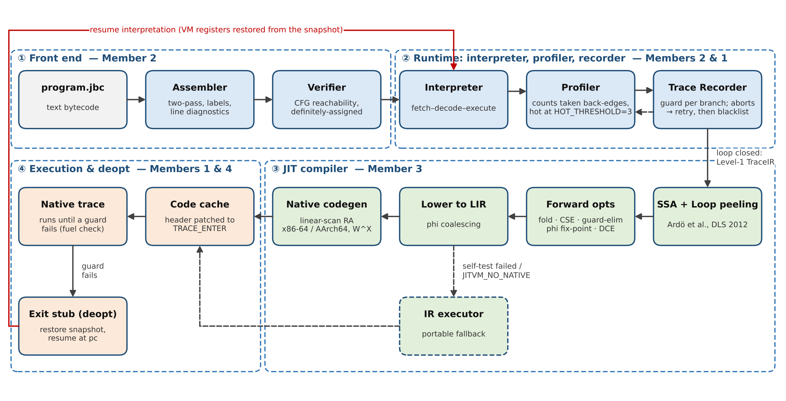
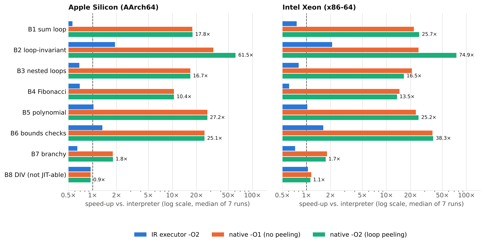

# Trace-Based JIT Compiler for a Custom Bytecode Virtual Machine

**BCSE307 Compiler Design – Project A2 – Team 6 – Review 3 (final)**
Yadesh Waran M (24BCE2402) · Emmanuel Joshy (24BCE0916) · Tanvi Gupta (24BAI0254) · Atul Vipin (24BCE2465)
Faculty: Dr. Shalini L · Repository: <https://github.com/Yadesh-005/JIT>

A mixed-mode virtual machine: programs written in a small register bytecode are
interpreted; hot loops are detected, recorded as linear traces, optimised in SSA form,
compiled to **real native machine code (x86-64 and AArch64/Apple Silicon)** and executed,
with snapshot-based **deoptimisation** back to the interpreter when an assumption fails.
The Review 3 novelty implements **loop peeling** from Ardö, Bolz & Fijałkowski,
*Loop-Aware Optimizations in PyPy's Tracing JIT* (DLS 2012): loop-invariant code
motion obtained from ordinary forward optimisations.

| | Apple Silicon (AArch64) | Intel Xeon (x86-64) |
|---|---|---|
| Speed-up vs. interpreter, loop benchmarks B1–B6 | **10×–62×** | **14×–75×** |
| Loop peeling (-O2) vs. -O1 on loop-invariant code (B2) | **1.9×** | **3.0×** |
| Automated checks | 183/183 + 27/27 CLI | 183/183 + 27/27 CLI |
| Differential runs (JIT vs. interpreter) | 3,520 identical | 3,520 identical |

## Start here

New to the code? Read **`docs/LEARNING_GUIDE.md`** first: it follows one program through every stage of the
JIT and explains each concept in plain language. `docs/GUIDELINE_COMPLIANCE.md` maps every Review 3
requirement to where it is met.

## Quick start

Requirements: a C++17 compiler (Apple clang from the Xcode Command Line Tools, or g++ ≥ 9 / clang ≥ 10), `make`. No other dependencies. Python 3 + matplotlib only to redraw charts.

```bash
make            # builds build/jitvm, build/jit_tests, build/jit_bench
make test       # unit + golden + differential + fuzz + CLI tests
make bench      # benchmarks -> results/bench_<arch>.csv
./demo.sh       # guided live demo (Review 3 demonstration sequence)
```

No `make`? Run `./build.sh`. On macOS install the compiler with `xcode-select --install`.

```bash
./build/jitvm tests/programs/01_valid_stable_loop.jbc        # run with JIT event log
./build/jitvm --compare bench/programs/b2_loop_invariant.jbc  # interpreter vs JIT + speed-up
./build/jitvm -q -O2 --dump-ir --dump-asm tests/programs/12_loop_invariant.jbc
./build/jitvm --help
```

## The bytecode (.jbc)

One instruction per line; labels end with `:`; comments start with `;`, `#` or `//`.
Registers R0–R15 (32-bit, start at 0, two's-complement wrap-around).

| Opcode | Operands | Meaning | JIT |
|---|---|---|---|
| `LOAD_CONST` | rd, imm | rd = imm (decimal, negative, 0x hex) | ✓ |
| `ADD_INT` / `SUB_INT` / `MUL_INT` / `AND_INT` | rd, ra, rb | rd = ra op rb | ✓ |
| `MOV` | rd, ra | rd = ra | ✓ (copy-propagated) |
| `JUMP_IF_LT` / `JUMP_IF_EQ` | ra, rb, target | branch if ra < rb / ra == rb | ✓ guard |
| `JUMP` | target | unconditional jump | ✓ |
| `PRINT_REG` | ra | prints `Register Ra = value` | ✓ helper call |
| `DIV_INT` | rd, ra, rb | rd = ra / rb, runtime error if rb = 0 | ✗ interpreter only |
| `UNKNOWN_OP` | – | sentinel, skipped with a warning | ✗ |
| `HALT` | – | stop | – |

Targets are labels, `@index` or plain indices. Example:

```
      LOAD_CONST R0, 0
      LOAD_CONST R1, 1
      LOAD_CONST R2, 10
loop: ADD_INT    R0, R0, R1
      PRINT_REG  R0
      JUMP_IF_LT R0, R2, loop
      HALT
```

## Architecture



| Stage | File | What it does |
|---|---|---|
| Assembler | `src/assembler.cpp` | two-pass, labels, every error with its line number |
| Verifier | `src/verifier.cpp` | operand/target checks; CFG reachability; definitely-assigned data-flow analysis |
| Interpreter + profiler | `src/vm.cpp` | fetch-decode-execute; counts taken backward branches; HOT_THRESHOLD = 3 |
| Recorder | `src/recorder.cpp` | Level-1 TraceIR, a guard for every branch direction; aborts on length > 50, unsupported ops, inner loops, loop exit |
| Optimiser | `src/optimizer.cpp` | SSA, constant folding, algebraic simplification, CSE/GVN, guard elimination, **loop peeling**, phi fix-point, DCE |
| Lowering | `src/trace_ir.cpp` | SSA → LIR with phi coalescing and parallel copies |
| Native backend | `src/backend_native.cpp` | linear-scan register allocation; x86-64 and AArch64 encoders; W^X / `MAP_JIT`; forked self-test |
| IR backend | `src/backend_ir.cpp` | portable reference executor for the optimised IR (fallback) |
| Deoptimisation | `src/vm.cpp`, exit stubs | snapshots restore VM registers and resume at the right pc; fuel exits |

Execution modes: `--mode=interp`, `--backend=native|ir`, `-O0` (SSA only), `-O1` (forward
optimisations), `-O2` (default, + loop peeling). `JITVM_NO_NATIVE=1` forces the IR backend.
Exit codes: 0 ok · 1 usage · 2 assembly/verification error · 3 runtime error · 4 step limit · 5 `--compare` mismatch.

## Tests

`make test` runs `build/jit_tests` (10 sections, 183 checks) and `tests/run_cli_tests.sh` (27 checks):

* assembler and verifier unit tests (valid and invalid inputs);
* the 8 Review 2 test cases through the original `loadProgram(std::vector<Instruction>)` API;
* recorder/profiler behaviour, optimiser unit tests, SSA well-formedness;
* deoptimisation (mid-body side exits restore every register; fuel exit from an infinite loop);
* golden outputs for the 24 programs in `tests/programs/` (`tests/expected/`);
* differential matrix: every program × 2 backends × 3 levels × 5 hot thresholds vs. the interpreter (720 runs);
* random-program fuzzing: 400 generated terminating programs × 7 JIT configurations (2,800 runs);
* safety: step limit in interpreter and in native code, division by zero, rejected programs.

Logs from both machines are in `results/` (`test_log_*.txt`, `cli_test_log_*.txt`). The suite also passes under AddressSanitizer + UndefinedBehaviorSanitizer and builds warning-free with `-Wall -Wextra -pedantic -Wshadow -Wconversion`.

## Benchmarks



`build/jit_bench` runs `bench/programs/*.jbc` in six configurations (median of 7 runs, output
checked against the interpreter). Results: `results/bench_AArch64.csv` (Apple Silicon, measured
in a Linux arm64 VM on the demo Mac) and `results/bench_x86_64.csv` (Intel Xeon 2.1 GHz).
Charts are regenerated with `python3 results/plot_results.py`.

## Repository layout

```
src/            VM, front end, recorder, optimiser, backends, CLI (jitvm.cpp)
tests/          test_main.cpp, run_cli_tests.sh, programs/*.jbc, expected/*.out, errors/*.jbc
bench/          bench_main.cpp, programs/b1..b8 *.jbc
legacy/review2/ the Review 2 prototype, unchanged, for comparison (make legacy)
docs/           LEARNING_GUIDE.md (start here), DEMO_SCRIPT.md, VIVA_PREP.md,
                GUIDELINE_COMPLIANCE.md, CONTRIBUTION_LOG.md, figures/, previous_reviews/
results/        test and benchmark logs, CSVs, plot script
Review3_Report_Team6.docx/.pdf, Review3_Presentation_Team6.pptx
docs/previous_reviews/ Review 2 report and Review 3 guidelines (reference)
```

## Known limitations

* One linear trace per loop: no side traces / trace trees, so alternating branches (B7) gain only ~1.5–1.8×, and an outer loop containing an inner loop stays interpreted (the inner loop is compiled).
* DIV_INT and UNKNOWN_OP are never compiled; loops containing them are blacklisted (≈ 6 % profiling overhead, B8).
* 16 registers, 32-bit integers only; no memory/heap operations, calls or I/O beyond PRINT_REG.
* Native code generation is template-based (no instruction scheduling); register pools of 10 (x86-64) and 11 (AArch64).
* A trace whose path stops repeating (e.g. a program phase change, `24_phase_change`) keeps side-exiting; results stay correct but that phase runs mostly in the interpreter.
* The macOS-specific path (`MAP_JIT`, `pthread_jit_write_protect_np`) was not exercised by the automated logs, which ran on Linux; on the demo Mac run `make test` once — if the native self-test ever fails, the VM falls back to the IR executor automatically.

## Acknowledgements

All code in this repository was written for this project; no third-party code or libraries are
used beyond the C++ standard library and POSIX. Instruction encodings follow the Intel® 64 and
IA-32 Architectures SDM and the Arm® Architecture Reference Manual. The loop-peeling design follows
Ardö, Bolz & Fijałkowski (DLS 2012); linear-scan allocation follows Poletto & Sarkar (TOPLAS 1999).
Full references are in the Review 3 report. AI assistance (Claude) was used during development and
documentation; the team reviewed, tested and is responsible for all submitted work. See `LICENSE`.
